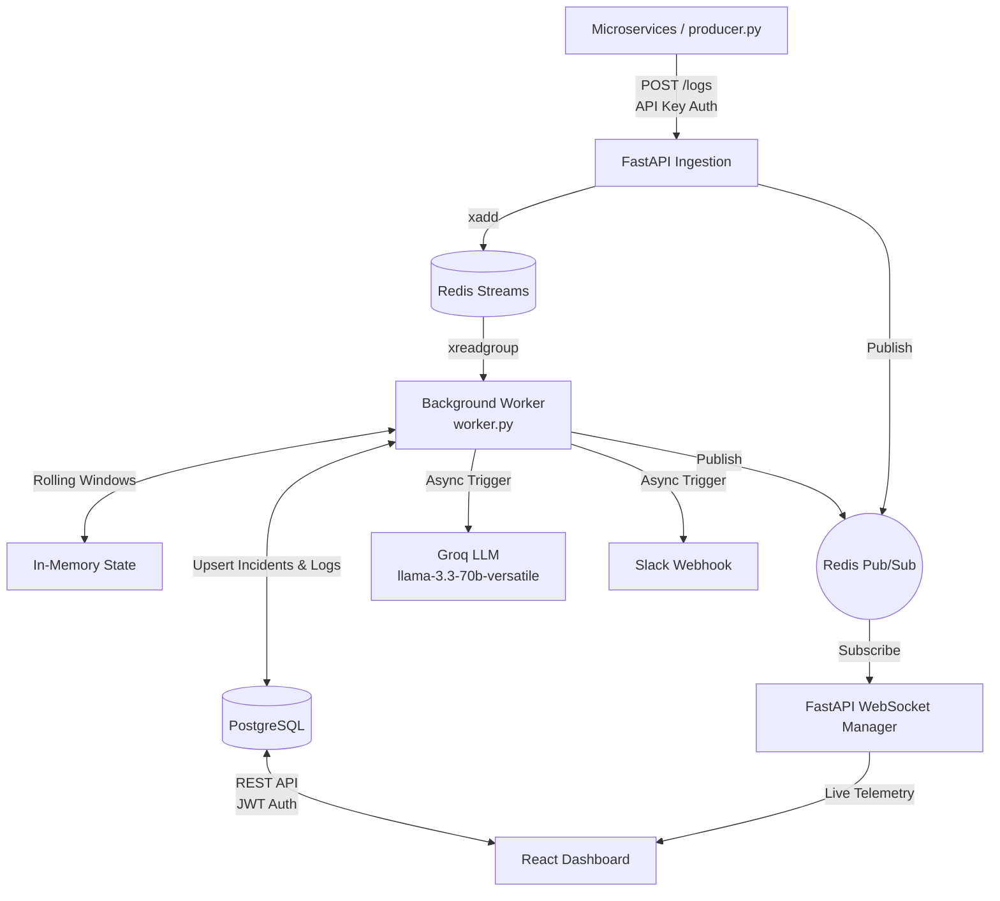

# IncidentOps

A real-time incident management platform with AI-assisted triage, live dashboards, and multi-channel alerting.

---

## 🚀 Overview

IncidentOps is a highly concurrent, real-time observability and incident response platform. It is designed to ingest thousands of logs per second from various microservices, instantly detect anomalies using rolling-window stream processing, and automatically generate AI-powered root cause analyses and Slack alerts for engineers. It also features a real-time WebSocket dashboard for live operational telemetry.

---

## 🏗️ Architecture



---

## 🛠️ Tech Stack

| Category | Technology |
| :--- | :--- |
| **Backend Framework** | Python 3.11+, FastAPI, Uvicorn |
| **Database** | PostgreSQL (via `asyncpg`) |
| **Message Broker** | Redis (`redis.asyncio` for Streams & Pub/Sub) |
| **AI Provider** | Groq (`llama-3.3-70b-versatile` via `httpx`) |
| **Real-Time Data** | WebSockets (via FastAPI & `websockets`) |
| **Authentication** | JWT (`python-jose`), Passlib/Bcrypt |
| **Infrastructure** | Docker Compose (for Postgres/Redis orchestration) |
| **Frontend** | React 19, Vite |

---

## ✨ Features

* **High-Throughput Ingestion**: Validates and buffers high-volume logs via Redis Streams, decoupling ingestion from heavy anomaly processing.
* **Stream Processing Anomaly Detection**: Evaluates three distinct anomaly rules in memory:
  1. **Error Rate Spike**: More than **10% errors** in a **60-second** window (minimum throughput of 20 logs).
  2. **Latency Spike**: Average response time in a **60-second** window exceeds **2.0x** the trailing 24-hour database baseline (auto-refreshed every 5 minutes).
  3. **Failure Burst**: **5 or more `ERROR` logs** from a single source within a tight **30-second** window.
* **Incident Deduplication**: Intelligently groups ongoing anomalies. If a rule continues to fire for a specific source, it updates the existing open incident metrics rather than spamming the database.
* **AI Root Cause Analysis**: When a brand new incident is generated, the system feeds the last 10 logs to a Groq LLM (Llama 3.3 70B) to generate a root cause hypothesis and actionable troubleshooting steps. Includes a robust internal rate limiter (max 5 calls/min) to prevent API exhaustion.
* **Slack Alerting**: Automatically sends a formatted webhook payload to Slack on new incident creation.
* **Live WebSocket Dashboard**: Connects the frontend to the backend via a Redis Pub/Sub bridged WebSocket, streaming delta log updates, incident creations, incident metric updates, and bucketed error-rate/latency history live to the browser (no polling).
* **Real Historical Metrics**: The dashboard's trend charts are backed by a real query bucketing `logs` into rolling 5-minute windows over the trailing hour, re-broadcast every 15s — not placeholder data.
* **Configurable Alert Thresholds**: The three detection rules' thresholds (error-rate %, latency multiplier, burst count) live in the database and are editable from the Admin page; the worker picks up changes within 5 minutes, no redeploy needed.
* **Secure JWT Authentication**: All human-facing REST and WebSocket endpoints are secured via expiring JSON Web Tokens.

---

## 🚦 Setup Instructions

1. **Clone the repository**:
   ```bash
   git clone <repo-url>
   cd incidentops
   ```

2. **Start the Infrastructure**:
   ```bash
   # Starts PostgreSQL and Redis
   docker compose up -d
   ```

3. **Configure the Environment**:
   Create a `backend/.env` file and populate it with the following keys:
   ```env
   DATABASE_URL=
   REDIS_URL=
   INGESTION_API_KEY=
   JWT_SECRET=
   JWT_ALGORITHM=HS256
   LLM_API_KEY=
   SLACK_WEBHOOK_URL=
   ADMIN_EMAIL=
   ADMIN_PASSWORD_HASH=
   ```

4. **Initialize the Database**:
   ```bash
   cd backend
   python scripts/migrate.py
   ```
   Applies everything in `app/db/migrations/` in order, tracked in a `schema_migrations` table so it's safe to re-run after pulling new migrations.

5. **Run the Backend Services**:
   ```bash
   cd backend
   pip install -r requirements.txt
   
   # Start the FastAPI Server (Port 8000)
   python -m uvicorn app.main:app --reload
   
   # Start the Stream Worker (in a separate terminal)
   python -m app.worker
   ```

6. **Run the Frontend**:
   ```bash
   cd frontend
   npm install
   npm run dev
   ```

---

## 🌐 API Endpoints

| Method | Path | Authentication | Description |
| :--- | :--- | :--- | :--- |
| **`POST`** | `/logs` | `X-API-Key` (Header) | Ingests a new log payload, validates it, and pushes it to the Redis stream. |
| **`GET`** | `/logs` | JWT (Header) | Lists recent logs, filterable by source/level/time range. |
| **`GET`** | `/logs/count` | JWT (Header) | Count of logs matching optional filters (used for the "Logs Today" KPI). |
| **`GET`** | `/incidents` | JWT (Header) | Lists all incidents, supporting filtering and sorting. |
| **`GET`** | `/incidents/{id}` | JWT (Header) | Fetches deep details for a specific incident, including AI summaries. |
| **`PATCH`** | `/incidents/{id}` | JWT (Header) | Updates an incident's status (e.g., `acknowledged`, `resolved`). |
| **`GET`** | `/metrics/timeseries` | JWT (Header) | Bucketed error-rate/latency history for the trailing hour (same series pushed live over the websocket). |
| **`GET`** | `/settings/thresholds` | JWT (Header) | Current alert-detection thresholds. |
| **`PUT`** | `/settings/thresholds` | JWT (Header) | Updates alert-detection thresholds; the worker picks them up on its next refresh. |
| **`POST`** | `/auth/login` | None | Validates credentials and returns an expiring access token. |
| **`GET`** | `/health` | None | Returns connectivity status for DB, Redis, and calculates exact Stream Consumer lag. |
| **`WS`** | `/ws/dashboard` | JWT (Query Param) | WebSocket endpoint for live log streaming, incident updates, and metrics broadcasts. |

---

## 📁 Project Structure

```text
incidentops/
├── backend/
│   ├── app/
│   │   ├── db/
│   │   │   ├── database.py
│   │   │   └── migrations/     # Numbered raw SQL migrations
│   │   ├── routers/
│   │   │   ├── auth.py
│   │   │   ├── incidents.py
│   │   │   ├── logs.py
│   │   │   ├── metrics.py
│   │   │   ├── settings.py
│   │   │   └── ws.py
│   │   ├── config.py
│   │   ├── llm.py
│   │   ├── main.py
│   │   ├── metrics.py          # Timeseries aggregation + live broadcaster task
│   │   ├── redis_client.py
│   │   ├── slack.py
│   │   ├── worker.py
│   │   └── ws_manager.py
│   ├── scripts/
│   │   ├── producer.py         # Simulates organic & burst microservice traffic
│   │   ├── migrate.py          # Applies pending SQL migrations
│   │   ├── test_*.py           # Manual integration scripts (see scripts/README.md)
│   │   └── verify_*.py
│   └── requirements.txt
├── frontend/
│   └── src/                    # React / Vite application
├── docker-compose.yml
├── render.yaml                 # Render Blueprint: api + worker + db + redis
└── README.md
```

---

## ☁️ Deployment

The frontend and backend deploy to different kinds of platforms — the
backend needs a host that supports long-running processes and websockets
(the worker never exits, and `/ws/dashboard` holds a persistent
connection), which rules out purely serverless platforms like Vercel for
it.

**Backend — Render:**

`render.yaml` at the repo root is a Render [Blueprint](https://render.com/docs/blueprint-spec) —
it provisions the API web service, the worker, a Postgres database, and a
Redis (Key Value) instance in one go, wired together automatically.

1. In the Render dashboard: **New → Blueprint**, point it at this repo.
   Render reads `render.yaml` and shows you the four resources it's about
   to create.
2. Render will prompt for the env vars marked `sync: false` — fill in
   `INGESTION_API_KEY`, `JWT_SECRET`, `ADMIN_EMAIL`, `ADMIN_PASSWORD_HASH`,
   `LLM_API_KEY`, `SLACK_WEBHOOK_URL` on **both** the web and worker
   services. Generate fresh values — don't reuse local dev ones.
   `DATABASE_URL`/`REDIS_URL` are wired automatically from the provisioned
   database/Key Value instance.
3. Deploy. Then run `python scripts/migrate.py` once, from a Render Shell
   session on the `incidentops-api` service, to create the schema.
4. Once you have the Vercel frontend's URL, set `CORS_ORIGINS` on the web
   service to it (comma-separated if you need more than one).

Cost note: `render.yaml` puts the web service and worker on the `starter`
plan (~$7/mo each, and workers have no free tier at all) but leaves
Postgres and Key Value on `free`. That's the cheapest way to keep the app
itself always-on and responsive. The tradeoff: the free Postgres instance
is deleted after 30+14 days unless upgraded — fine here since this
project's data is synthetic demo traffic (re-run `migrate.py` and restart
`scripts/producer.py` after recreating it), and the free Key Value loses
its data on restart, which only means losing a few in-flight log entries.
Bump either plan in `render.yaml` if you want it fully durable instead.

**Frontend — Vercel:**
1. Import this repo, set the project's root directory to `frontend/`.
2. Set `VITE_API_URL` to the backend's public Railway URL
   (`https://your-service.up.railway.app`) — the websocket URL is derived
   from it automatically (`https` → `wss`).
3. Deploy. Vercel auto-detects the Vite build.

---

## ⚠️ Known Limitations / Next Steps

1. **User Management**: Currently, the system relies on a single hardcoded admin user (defined in the environment via `ADMIN_EMAIL` and `ADMIN_PASSWORD_HASH`). A full RBAC user management system and database table are needed for production.
2. **Dockerization**: While PostgreSQL and Redis run in Docker, the FastAPI application and the Python worker currently run natively on the host machine for local development. A unified `docker-compose` setup encompassing the app/worker containers is a logical next step.
3. **Database Migrations**: `scripts/migrate.py` applies raw SQL files in order and tracks what's run in `schema_migrations` — it isn't a full tool like Alembic (no down-migrations, no autogeneration from model diffs), but it replaces manual DB commands.
4. **Automated Test Suite**: `backend/scripts/test_*.py` are manual, full-stack integration scripts (they boot the API + worker as subprocesses) rather than a CI-friendly `pytest` suite with fixtures/mocks.
