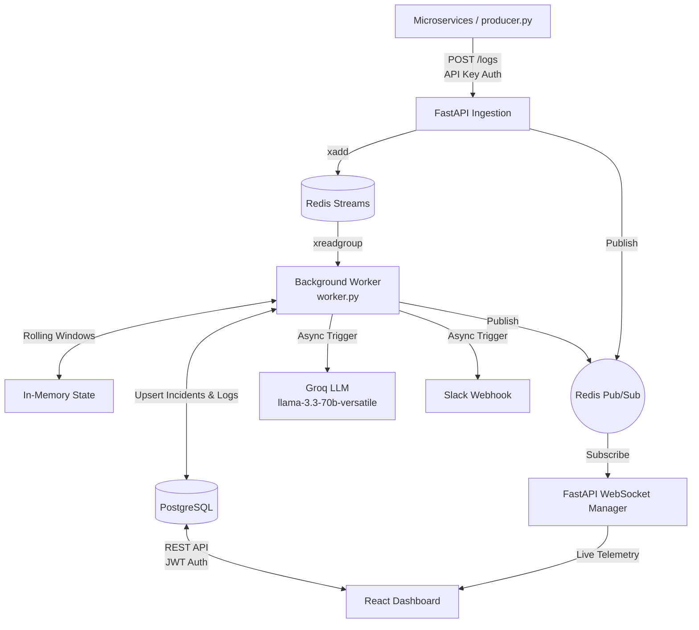

# IncidentOps

A real-time incident management platform with AI-assisted triage, live dashboards, and multi-channel alerting.

---

## 🚀 Overview

IncidentOps is a highly concurrent, real-time observability and incident response platform. It is designed to ingest thousands of logs per second from various microservices, instantly detect anomalies using rolling-window stream processing, and automatically generate AI-powered root cause analyses and Slack alerts for engineers. It also features a real-time WebSocket dashboard for live operational telemetry.

---

## 🏗️ Architecture



---

## 🛠️ Tech Stack

| Category | Technology |
| :--- | :--- |
| **Backend Framework** | Python 3.11+, FastAPI, Uvicorn |
| **Database** | PostgreSQL (via `asyncpg`) |
| **Message Broker** | Redis (`redis.asyncio` for Streams & Pub/Sub) |
| **AI Provider** | Groq (`llama-3.3-70b-versatile` via `httpx`) |
| **Real-Time Data** | WebSockets (via FastAPI & `websockets`) |
| **Authentication** | JWT (`python-jose`), Passlib/Bcrypt |
| **Infrastructure** | Docker Compose (for Postgres/Redis orchestration) |
| **Frontend** | React, Vite (Phase 6) |

---

## ✨ Features

* **High-Throughput Ingestion**: Validates and buffers high-volume logs via Redis Streams, decoupling ingestion from heavy anomaly processing.
* **Stream Processing Anomaly Detection**: Evaluates three distinct anomaly rules in memory:
  1. **Error Rate Spike**: More than **10% errors** in a **60-second** window (minimum throughput of 20 logs).
  2. **Latency Spike**: Average response time in a **60-second** window exceeds **2.0x** the trailing 24-hour database baseline (auto-refreshed every 5 minutes).
  3. **Failure Burst**: **5 or more `ERROR` logs** from a single source within a tight **30-second** window.
* **Incident Deduplication**: Intelligently groups ongoing anomalies. If a rule continues to fire for a specific source, it updates the existing open incident metrics rather than spamming the database.
* **AI Root Cause Analysis**: When a brand new incident is generated, the system feeds the last 10 logs to a Groq LLM (Llama 3.3 70B) to generate a root cause hypothesis and actionable troubleshooting steps. Includes a robust internal rate limiter (max 5 calls/min) to prevent API exhaustion.
* **Slack Alerting**: Automatically sends a formatted webhook payload to Slack on new incident creation.
* **Live WebSocket Dashboard**: Connects the frontend to the backend via a Redis Pub/Sub bridged WebSocket, streaming delta log updates, incident creations, and incident metric updates live to the browser.
* **Secure JWT Authentication**: All human-facing REST and WebSocket endpoints are secured via expiring JSON Web Tokens.

---

## 🚦 Setup Instructions

1. **Clone the repository**:
   ```bash
   git clone <repo-url>
   cd incidentops
   ```

2. **Start the Infrastructure**:
   ```bash
   # Starts PostgreSQL and Redis
   docker compose up -d
   ```

3. **Configure the Environment**:
   Create a `backend/.env` file and populate it with the following keys:
   ```env
   DATABASE_URL=
   REDIS_URL=
   INGESTION_API_KEY=
   JWT_SECRET=
   JWT_ALGORITHM=HS256
   LLM_API_KEY=
   SLACK_WEBHOOK_URL=
   ADMIN_EMAIL=
   ADMIN_PASSWORD_HASH=
   ```

4. **Initialize the Database**:
   *(Run the raw SQL migrations/schemas inside the Postgres container or via a script once added).*

5. **Run the Backend Services**:
   ```bash
   cd backend
   pip install -r requirements.txt
   
   # Start the FastAPI Server (Port 8000)
   python -m uvicorn app.main:app --reload
   
   # Start the Stream Worker (in a separate terminal)
   python -m app.worker
   ```

6. **Run the Frontend (Phase 6)**:
   ```bash
   cd frontend
   npm install
   npm run dev
   ```

---

## 🌐 API Endpoints

| Method | Path | Authentication | Description |
| :--- | :--- | :--- | :--- |
| **`POST`** | `/logs` | `X-API-Key` (Header) | Ingests a new log payload, validates it, and pushes it to the Redis stream. |
| **`GET`** | `/incidents` | JWT (Header) | Lists all incidents, supporting filtering and sorting. |
| **`GET`** | `/incidents/{id}` | JWT (Header) | Fetches deep details for a specific incident, including AI summaries. |
| **`PATCH`** | `/incidents/{id}` | JWT (Header) | Updates an incident's status (e.g., `acknowledged`, `resolved`). |
| **`POST`** | `/auth/login` | None | Validates credentials and returns an expiring access token. |
| **`GET`** | `/health` | None | Returns connectivity status for DB, Redis, and calculates exact Stream Consumer lag. |
| **`WS`** | `/ws/dashboard` | JWT (Query Param) | WebSocket endpoint for live log streaming and incident updates. |

---

## 📁 Project Structure

```text
incidentops/
├── backend/
│   ├── app/
│   │   ├── db/
│   │   │   └── database.py
│   │   ├── routers/
│   │   │   ├── auth.py
│   │   │   ├── incidents.py
│   │   │   ├── logs.py
│   │   │   └── ws.py
│   │   ├── config.py
│   │   ├── llm.py
│   │   ├── main.py
│   │   ├── redis_client.py
│   │   ├── slack.py
│   │   ├── worker.py
│   │   └── ws_manager.py
│   ├── scripts/
│   │   ├── producer.py         # Simulates organic & burst microservice traffic
│   │   └── test_*.py           # Integration test scripts
│   └── requirements.txt
├── frontend/
│   └── src/                    # React / Vite application
├── docker-compose.yml
└── README.md
```

---

## ⚠️ Known Limitations / Next Steps

1. **User Management**: Currently, the system relies on a single hardcoded admin user (defined in the environment via `ADMIN_EMAIL` and `ADMIN_PASSWORD_HASH`). A full RBAC user management system and database table are needed for production.
2. **Dockerization**: While PostgreSQL and Redis run in Docker, the FastAPI application and the Python worker currently run natively on the host machine for local development. A unified `docker-compose` setup encompassing the app/worker containers is a logical next step.
3. **Database Migrations**: The system lacks an automated migration tool (like Alembic); schemas are currently initialized via raw scripts or manual DB commands.
